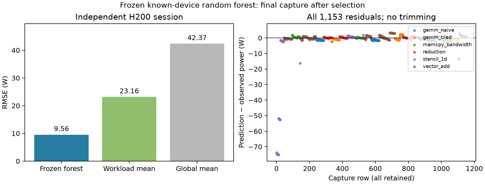
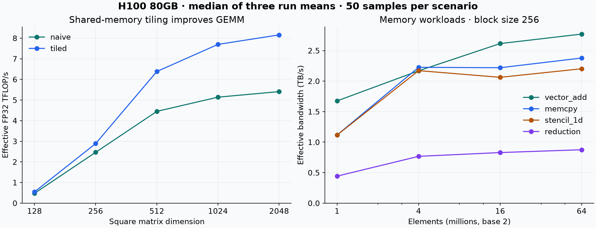

# GPU Performance & Power Analyzer

An end-to-end GPU telemetry ML workflow: collect correctness-verified CUDA measurements, build a provenance-checked SQL dataset, evaluate models on held-out sessions and devices, and serve versioned artifacts through a validated API. Kernel timing and measured power connect model results to reproducible hardware experiments.

[Research report](docs/research-report.md) · [Figure gallery](results/research-2026-10-20/README.md) · [Model card](docs/model-card.md) · [Methodology](docs/methodology.md) · [Reproduce](docs/reproducibility.md)

**Python · SQL · scikit-learn · FastAPI · CUDA/C++ · GitHub Actions**

| Evidence | Measured outcome |
| --- | --- |
| Prospective ML evaluation | **9.56 W RMSE**, **58.7% lower** than the workload baseline on a new H200 session |
| Hardware experiments | **44,400** scaling timings across H100, H200, GH200 and DGX Spark GB10 |
| Verified dataset | **5 captures**, **120 workload windows**, **10,301 raw readings** |
| Inference contract | All **1,153** new H200 rows match saved-model predictions; unknown GPU names are rejected |

Start with the [research report](docs/research-report.md) for the question, experiment design, all seven figures and limitations. The [model card](docs/model-card.md) explains the actual inputs, forest and supported scope; the [engineering guide](docs/engineering.md) explains implementation choices.

## Model result you can inspect

A random forest selected on whole-trial H100/H200 development folds was frozen before a **new H200 capture: 24 verified workload windows and 1,153 steady telemetry rows**. It achieved **9.56 W RMSE**, improving **58.7%** over a training-workload-mean baseline (23.16 W). All rows were retained: 24 errors exceeded 25 W, primarily on stencil workloads. This is one prospective session on a known GPU; it does not establish unseen-GPU accuracy. [Final metrics and residuals →](results/quality-2026-10-20/h200-independent/evaluation/evaluation.json)

On independent GH200 data, the frozen cross-device workload-mean winner scored **34.71 W RMSE**, the known-device forest scored **42.99 W**, and a historical H100 linear reference scored **30.84 W**. No test-driven winner change was made. On DGX Spark GB10, transfer failed: the frozen cross-device baseline scored **391.27 W RMSE** and the known-device forest **379.28 W**. Collection compatibility across four GPUs does not establish model portability; the serving guard limits these models to their H100/H200 reference identities. [Model selection and limits →](docs/model-generalization.md)



The warehouse currently contains **5 captures across 4 GPUs**, **10,301 raw readings**, **5,689 steady rows** and **120 verified workload windows**, with integrity checks and idempotent ingestion. API replay of all **1,153 new H200 rows** exactly matched the saved model (**0 W difference**). [Curated validation archive](results/quality-2026-10-20/README.md) · [SQL contract](docs/warehouse.md) · [Serving contract](docs/serving.md)

## Results you can inspect

Validated on **NVIDIA H100 80GB HBM3**, with recovered **A100 80GB PCIe** evidence for comparison. Additional [H200](docs/h200-review.md) and native Arm [GH200 validation](docs/gh200-validation.md) each completed the 74-configuration, three-sweep timing protocol and 18 boundary cases; their selected captures and validation receipts are retained in the [repository evidence archive](results/quality-2026-10-20/README.md). Native Arm [DGX Spark GB10](docs/dgx-spark-validation.md) also completed the same full timing protocol; its 24-window power capture also passed artifact validation. Across H100, H200, GH200 and GB10, the three scaling sweeps retain **44,400 timing samples**. The H100 study covers **74 configurations × 3 independent sweeps × 50 samples = 11,100 raw timings**, plus a 24-scenario compatibility run and 18 boundary correctness cases. All requested correctness checks passed.

| H100 workload | Result | Evidence |
| --- | --- | --- |
| FP32 GEMM, 2048 × 2048 | Tiled: **8.16 TFLOP/s**, **1.51×** naive | Median of three run means |
| Vector add, 67.1M elements, 256 threads/block | **2.77 TB/s** effective bandwidth | Declared bytes / measured runtime |
| A100 → H100, tiled GEMM, 512 × 512 | **1.65×** observed speedup | 69.91 → 42.26 μs in matched scenarios |
| Repeatability across 74 configurations | Largest run-mean spread: **3.17%** | All three sweeps retained |

Cross-GPU ratios describe the captured runs: compiler versions, source revisions, and dates differ. Effective throughput is derived, not a hardware counter. Two configurations exceeded 10% within-run CV in at least one trial; the comparison report flags that noise. [Methodology, counters, and limitations →](docs/real_gpu_validation.md)



## Measured power and optimization

The H100 power study covers **8 configurations × 3 randomized trials**, with **2,023 raw telemetry readings**. All 24 workloads passed correctness checks.

| FP32 GEMM, 2048 × 2048 | Sustained throughput | Measured board power | Estimated energy / launch |
| --- | ---: | ---: | ---: |
| Naive | 5.41 TFLOP/s | 471.4 W | 1.496 J |
| Tiled | 8.19 TFLOP/s | 408.0 W | 0.856 J |

Tiled GEMM achieved **1.51× throughput and 42.8% lower estimated energy per launch**. Power is sampled board telemetry; energy per launch combines steady mean power with sustained launch rate. [Raw evidence, all workloads, and sampling limits →](results/h100-power-2026-09-22/REPORT.md)

Power models use separate artifacts and hold out entire trials. Linear regression achieved **3.11 W mean held-out RMSE** across three folds. This validates repeat-session behavior on one H100; a fixed H100-trained model subsequently scored **56.78 W RMSE on H200**, underperforming both training-only mean baselines. [External-device evaluation →](docs/h200-review.md) [Model evidence →](results/h100-power-model-2026-09-22/REPORT.md) [Methodology and commands](docs/power_measurement.md) · [Integration review](docs/repository_integration.md) · [GPU validation plan](docs/gpu_validation_plan.md)

## The machine learning model

The selected model predicts contemporaneous GPU sensor power from five numeric telemetry fields and two categorical fields. Training-only preprocessing feeds a 64-tree random forest; the prediction is the mean of its tree outputs. A separate device-transfer objective selected a workload-mean baseline.


[Complete model card](docs/model-card.md) · [All 12 candidates and validation folds](results/research-2026-10-20/04_model_selection.png) · [Full prospective residual analysis](results/research-2026-10-20/05_prospective_h200.png) · [External-device failures](results/research-2026-10-20/06_external_device_failure.png)

## How the research works


- **Bounded worker execution:** subprocess timeouts, checked JSON responses, exact scenario matching, and fail-fast correctness checks.
- **Reproducible evidence:** every timing sample, GPU UUID and metadata, binary/config/source hashes, and separate metric provenance.
- **Regression checks:** compare matching configurations, flag missing coverage and noisy measurements, export JSON/CSV/Markdown, and return CI exit codes.
- **Data and serving contracts:** verified artifact hashes, atomic SQL ingestion, bounded inference batches, readiness checks, and rejection of unseen GPU identities.
- **Portable validation:** CPU-only fixtures exercise orchestration and analysis; CUDA runs validate kernel behavior separately.

The system retains raw files, supports transactional SQLite ingestion, and serves versioned models through a validated FastAPI contract. [SQL warehouse](docs/warehouse.md) · [Serving contract](docs/serving.md) · [Quality validation](docs/quality-validation.md). [Design decisions and current limits →](docs/engineering.md) · [Resume sweeps safely](docs/resumability.md) · [Tune block sizes](docs/autotuning.md)

## Reproduce without a GPU

Use Python 3.11 for the recorded research environment. These commands read only checked-in measurements:

```bash
python3.11 -m venv .venv
source .venv/bin/activate
python -m pip install -e ".[power,api]" -c requirements-research.txt

# Rebuild all seven figures and their calculation tables.
python scripts/plot_research_results.py

# Reconstruct the frozen forest and verify every archived final prediction.
python scripts/reproduce_frozen_model.py --outdir outputs/model-replay

# Serve the reconstructed model; visit http://127.0.0.1:8000/docs.
GPU_POWER_REGISTRY_DIR=outputs/model-replay/registry \
  GPU_POWER_MODEL_NAME=rf_unbounded_full GPU_POWER_MODEL_VERSION=latest \
  python -m uvicorn gpu_power_pipeline.api:app --host 127.0.0.1 --port 8000
```

Model replay verifies the original input/configuration/source hashes, trains on the 2,276 development rows, and compares all 3,413 archived H200/GH200/GB10 predictions. It is retrospective reproduction; the original prospective result retains its original freeze and capture records. Use a fresh output directory for each replay. [SQL rebuild, checksums and complete reproduction guide →](docs/reproducibility.md)

Open the [figure gallery](results/research-2026-10-20/README.md) for PNG/SVG exports and underlying CSV calculations. No CUDA installation is needed for this path. The [fixture demo](docs/demo.md) separately exercises orchestration with explicitly synthetic timings.

## Run on your GPU

Requires an NVIDIA GPU, CUDA Toolkit (`nvcc`), and CMake 3.21+.

```bash
cmake -S benchmarks -B build -DCMAKE_BUILD_TYPE=Release
cmake --build build --config Release -j 4

python -m gpu_kernel_analyzer benchmark sweep \
  --binary build/gpu_benchmark \
  --scenarios configs/benchmark_scenarios.yaml \
  --outdir outputs/run

python -m gpu_kernel_analyzer artifacts validate --run-dir outputs/run
python -m gpu_kernel_analyzer analyze full --run-dir outputs/run
```

Use a new output directory for each sweep. The default suite has 24 scenarios. For the larger repeated study, run `PYTHON=python bash scripts/cross_validate_gpu.sh`; see [reproducibility](docs/reproducibility.md) for build settings and the published capture commands.

## Gate a performance change

Capture `outputs/before` and `outputs/after` on the same GPU, then:

```bash
python -m gpu_kernel_analyzer compare \
  --baseline outputs/before --candidate outputs/after \
  --outdir outputs/regression --threshold-pct 5 \
  --fail-on-regression
```

The default statistic is median runtime. The gate fails for a slowdown over the threshold, excessive within-run variability, missing baseline coverage, or changed device/warmup/repeat settings. Cross-device comparisons require explicit opt-in and cannot pass a CI gate. [Policy and exit codes →](docs/comparisons.md)

## Tune for measured energy

The `autotune run` command searches existing kernel and block-size choices using correctness-gated sustained board power and runtime measurements. It selects the lowest-energy candidate within 5% of the fastest measured candidate, then independently checks the speed-eligible choices. The H100 vector-add example selected block 256 as the fastest practical recommendation; its unique energy advantage remains unconfirmed under the dispersion screen. [Autotuning guide and evidence →](docs/autotuning.md)

## Workloads and measurement scope

| Kernel | What it exercises |
| --- | --- |
| `vector_add` | Three-array streaming access |
| `memcpy_bandwidth` | Device-to-device copy kernel |
| `stencil_1d` | Neighbor reads and boundary handling |
| `reduction` | Shared-memory tree reduction into block partial sums |
| `gemm_naive` | FP32 matrix multiplication with direct global reads |
| `gemm_tiled` | FP32 matrix multiplication using 16 × 16 shared-memory tiles |

CUDA events measure kernel execution; allocations, host/device copies, and CPU verification are outside the timed interval. Reduction timing excludes the final CPU aggregation. GEMM uses ordinary FP32 arithmetic, not Tensor Cores or cuBLAS. Verification uses seeded nonuniform inputs and checks every output, including every reduction block partial. Small GEMMs use arbitrary dense matrices; large GEMMs use a structured nonuniform input with a closed-form oracle to avoid cubic CPU work. [Oracle coverage and GPU validation details →](docs/correctness.md)

Nsight Compute supplies optional hardware counters for exact scenarios. Model predictions stay in separate files. The optional ridge model and tuning advisor are exploratory; [usage and limitations](docs/modeling.md) are documented separately.

## Code and tests

```text
benchmarks/                CUDA kernels, event timing, JSON worker
src/gpu_kernel_analyzer/   Timing, sustained power capture, comparison, reporting
src/gpu_power_pipeline/    Power models, telemetry adapters, SQL warehouse, registry, API
configs/                   Baseline, scaling, and boundary suites
results/                   Raw multi-GPU evidence, frozen evaluations, scientific figures
scripts/                   GPU validation and result regeneration
tests/                    CPU tests and deterministic worker fixture
docs/                     Methodology, design, reproduction, and results
```

```bash
python -m pip install -e ".[dev,power,api,lint]"
python -m pytest -q
ruff check .
```

The final local check passed **254 CPU tests**. GitHub Actions runs CPU tests on Python 3.10–3.12 and lint checks. Research checks verify archive/figure hashes and reconstruct the selected forest against archived predictions. Native GPU performance is measured separately from hosted CPU CI.

[MIT license](LICENSE) · [Power-pipeline attribution](third_party/gpu-power-modeling/ORIGIN.md)
