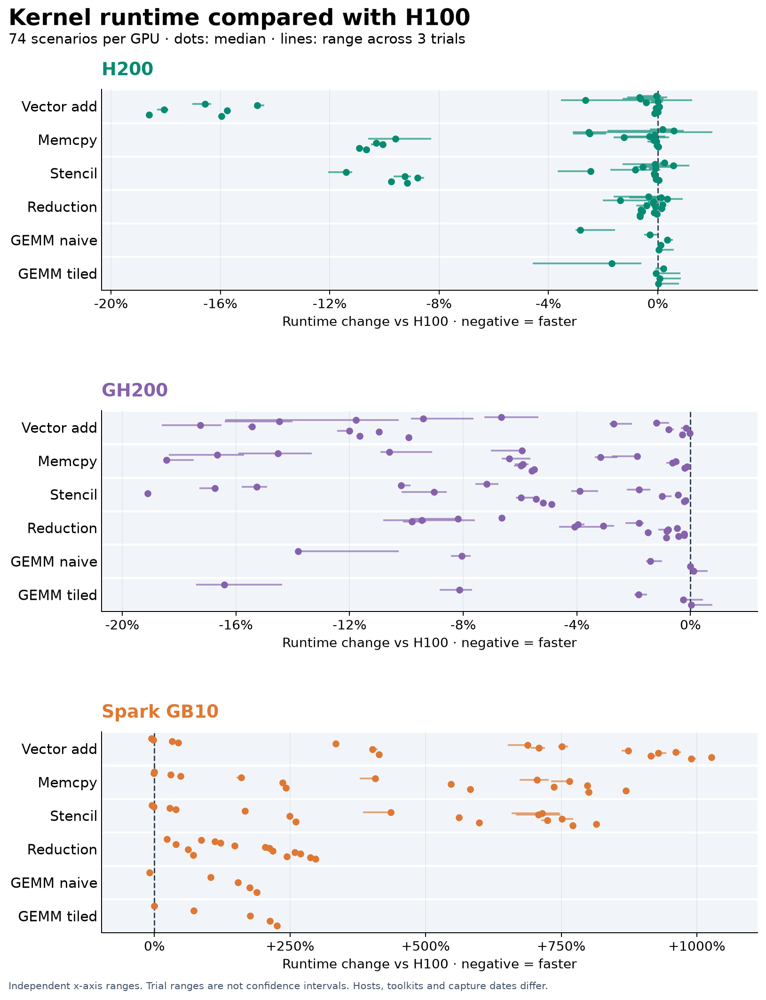

# GPU Performance & Power Analyzer

Benchmark CUDA kernels, compare performance changes, measure GPU power, and train and serve telemetry-based power models.

**CUDA/C++ · Python · SQLite · scikit-learn · FastAPI**

## Features

- Six correctness-checked kernels: vector add, copy, stencil, reduction, naive GEMM, and tiled GEMM.
- Resumable sweeps with raw timings, device metadata, and source/configuration hashes.
- Regression gates for matching scenarios; optional Nsight Compute counters.
- Sustained power capture and energy-aware block-size tuning.
- Transactional telemetry ingestion, held-out model evaluation, and versioned inference with input and GPU-identity validation.

## Install

Use Python 3.11 for the published research environment.

```bash
git clone https://github.com/jas0nriverah/gpu-kernel-performance-analyzer.git
cd gpu-kernel-performance-analyzer
python3.11 -m venv .venv
source .venv/bin/activate
python -m pip install -e '.[power,api]' -c requirements-research.txt
```

## Run a benchmark

Requires an NVIDIA GPU, CUDA Toolkit, and CMake 3.21+.

```bash
cmake -S benchmarks -B build -DCMAKE_BUILD_TYPE=Release
cmake --build build -j 4
python -m gpu_kernel_analyzer benchmark sweep \
  --binary build/gpu_benchmark \
  --scenarios configs/benchmark_scenarios.yaml --outdir outputs/run
python -m gpu_kernel_analyzer artifacts validate --run-dir outputs/run
python -m gpu_kernel_analyzer analyze full --run-dir outputs/run
```

Use a fresh output directory, or follow the [resume guide](docs/usage.md#resume-a-sweep). CUDA events time kernel execution only. GEMM uses FP32 arithmetic, not Tensor Cores; reduction excludes final CPU aggregation.

## Measured results

44,400 timing samples across H100, H200, GH200, and GB10. Each panel below has its own linear range. Negative percentages mean faster than H100; dots show individual scenarios and lines show the three-trial range.



These are captured-run comparisons: hosts, toolkits, and collection dates differ. Use matching hardware and settings for [regression gates](docs/usage.md#compare-runs).

The frozen random forest achieved **9.56 W RMSE** on a new H200 session, versus **23.16 W** for the training workload-mean baseline. Transfer to unseen GPUs was poor: **42.99 W** on GH200 and **379.28 W** on GB10. The API restricts this model to its H100/H200 reference identities. See the [model card](docs/model-card.md) and [full results](results/research-2026-10-20/README.md), including residuals and baselines.

## Reproduce without a GPU

```bash
python scripts/verify_research_artifacts.py
python scripts/plot_research_results.py
python scripts/reproduce_frozen_model.py --outdir outputs/model-replay
```

Figures use checked-in measurements. Model replay rebuilds the frozen forest and checks archived predictions. See [reproduction](docs/reproducibility.md), [API serving](docs/serving.md), and the [CPU fixture demo](docs/usage.md#cpu-fixture).

## Development

```bash
python -m pip install -e '.[dev,power,api,lint]' -c requirements-research.txt
python -m pytest -q
ruff check .
```

CI runs CPU tests on Python 3.10–3.12, lint, artifact checks, and model replay. CUDA correctness and performance require separate GPU validation. The API requires deployment-level authentication, TLS, and resource limits; see [serving](docs/serving.md).

[Documentation](docs/README.md) · [Architecture](docs/engineering.md) · [Measurement methodology](docs/methodology.md) · [SQL warehouse](docs/warehouse.md) · [Autotuning](docs/usage.md#tune-block-sizes) · [MIT license](LICENSE) · [Attribution](third_party/gpu-power-modeling/ORIGIN.md)
