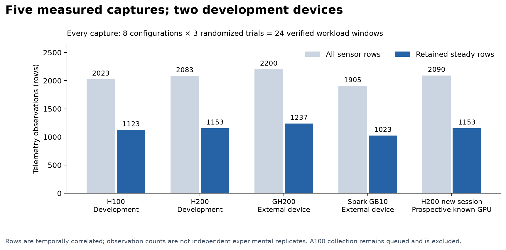
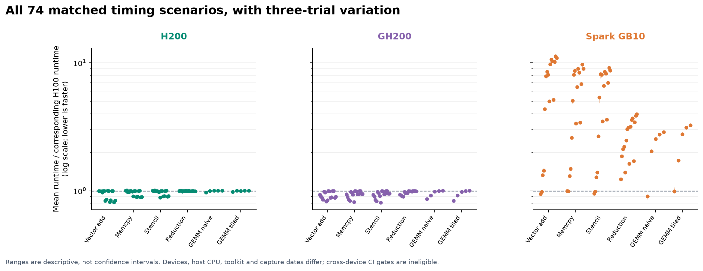
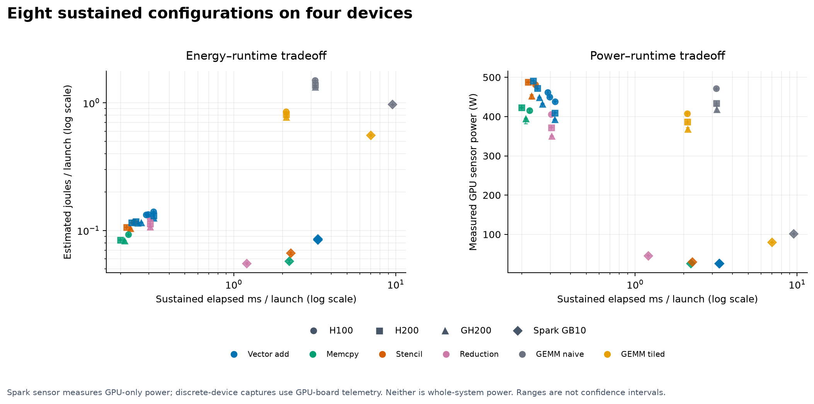
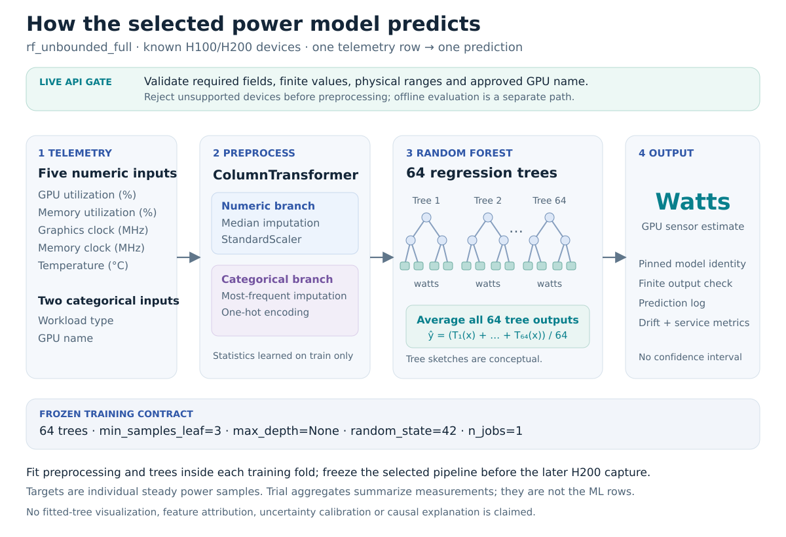
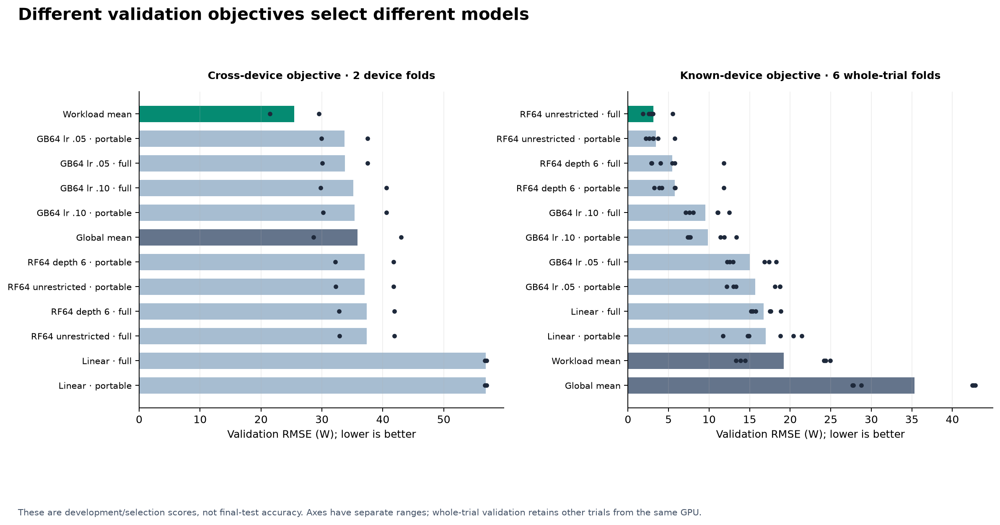
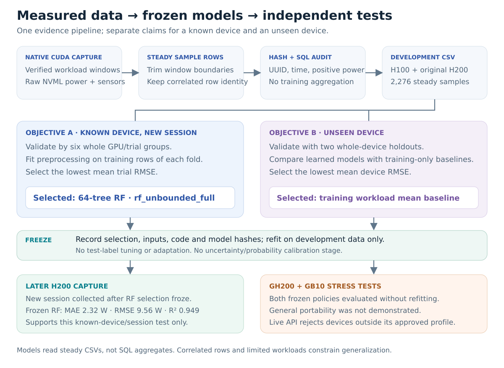
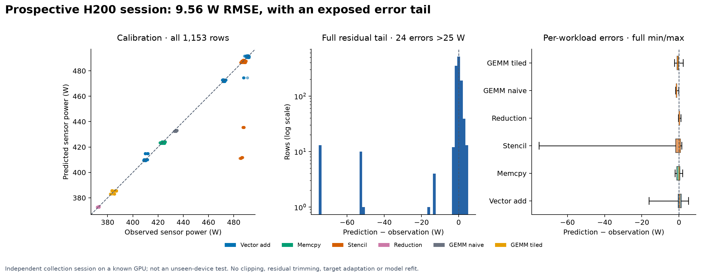
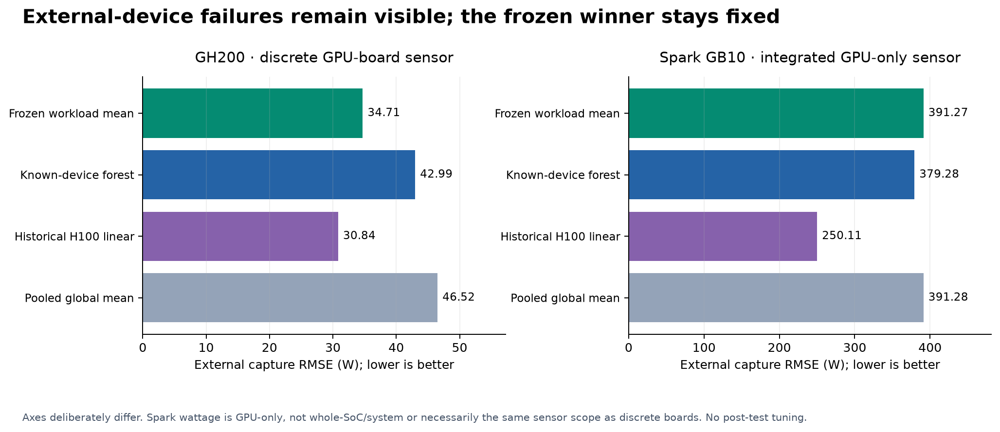
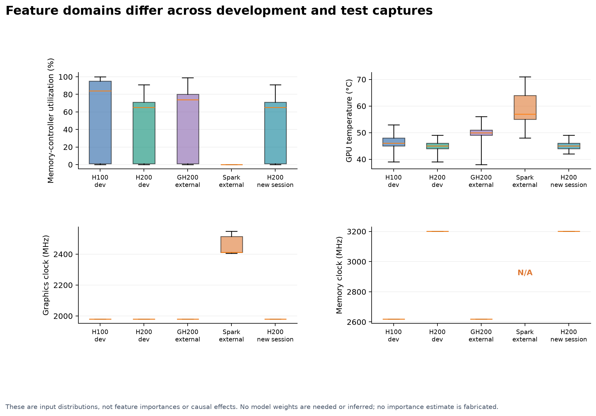

# GPU telemetry ML: prospective validation and transfer limits

This study connects correctness-verified CUDA workloads, measured GPU power, a relational dataset and frozen model evaluation. Its strongest ML result is a prospective session on a **known H200**: a frozen random forest achieved **9.556 W RMSE**, versus **23.157 W** for a training-workload-mean baseline (**58.734% reduction**). External GH200 and GB10 tests expose substantial portability limits. Hardware collection success and model accuracy are separate outcomes.

[Curated evidence and checksums](../results/quality-2026-10-20/README.md) · [All figures, editable SVGs and calculation data](../results/research-2026-10-20/README.md) · [Model card](model-card.md) · [Detailed methodology](methodology.md) · [Model implementation guide](modeling.md)

## Research questions

1. Can a model selected from previous H100/H200 sessions predict GPU power in a later session on an already-observed device?
2. Does selection on two development devices produce accurate predictions on unseen GPUs?
3. Can the collection, SQL and serving contracts preserve identity, provenance and failure visibility while hardware and telemetry support differ?

These are repository-scale experiments, not a claim of broad hardware generalization. The task predicts contemporaneous power from observed telemetry and workload; it is not forecasting future power without telemetry.

## Measurement and dataset

Six custom CUDA kernels exercise streaming vector addition/copy, stencil, reduction and naive/tiled FP32 GEMM. CUDA events measure kernel execution in milliseconds, excluding allocation, host transfers and reference verification. The scaling study uses 74 configurations, three separate sweeps and 50 samples per configuration: **11,100 scaling timing samples per device**, or **44,400** across H100, H200, GH200 and GB10. Baseline and boundary suites are separate. No Tensor Core or cuBLAS performance claim is made.

Power capture runs eight configurations for three randomized trials, with at least 15 seconds sustained execution per window. The first and last two seconds are excluded from steady telemetry. `nvidia-smi` power queries are requested at 0.2-second intervals; query overhead means achieved spacing differs. Means use trapezoidal integration divided by covered time, not an unweighted sample mean. Sensors may average internally and adjacent rows are correlated. See [power methodology](power_measurement.md).

The ML target is GPU sensor power in **watts** (`power_watts`), observed per telemetry row. Integrated energy is in **joules** and is not a predictive feature. Sensor scope is not whole-server energy. GB10's legacy manifest label `gpu_board` is interpreted as GPU-only sensor power, not CPU or total SoC/system power; unavailable memory clocks remain missing. [Spark sensor documentation](dgx-spark-validation.md) records the NVIDIA source and integrated-memory caveats.

| Capture | Role | Raw readings | Steady rows | Verified windows |
| --- | --- | ---: | ---: | ---: |
| H100 | Development, historical study | 2,023 | 1,123 | 24 |
| Original H200 | Development after historical transfer test | 2,083 | 1,153 | 24 |
| GH200 | External-device evaluation | 2,200 | 1,237 | 24 |
| Prospective H200 | Later known-device final evaluation | 2,090 | 1,153 | 24 |
| DGX Spark GB10 | Additional external-device evaluation | 1,905 | 1,023 | 24 |
| Total | Five captures, four GPU identities | 10,301 | 5,689 | 120 |

H100/H200 collection used x86_64 hosts; GH200/GB10 used native Arm environments and fresh native builds. Driver/toolkit, host, date and environment vary. These captures do not isolate the effect of GPU hardware. New A100 validation remains queued; historical A100 timing evidence is separate and no new A100 model result is claimed.

The SQLite warehouse stores runs, artifact digests, trial windows and raw telemetry. Manifest hashes, identities, finite physical values and steady/raw row agreement are checked before atomic insertion. Five-capture ingestion retains **269 artifact digest rows**, passes SQLite integrity/foreign-key checks and adds no rows on retry. Optional sensor absence is preserved, never replaced with fabricated zeros. [Final SQL receipt](../results/quality-2026-10-20/warehouse/warehouse-final-verification.json) · [Warehouse contract](warehouse.md)

## Hardware and dataset figures



Coverage is descriptive: rows and repeated workload windows do not represent independent population samples.



Each point is a matched scenario’s median candidate/H100 runtime ratio across three corresponding trial pairs; segments span those three ratios. Host, toolchain and capture differences prevent causal hardware attribution.



Power comes from the GPU sensor; launch timing and estimated joules per launch use the documented sustained-window protocol. GB10 sensor scope differs from whole-system power.

## Two objectives and a frozen candidate grid

The earlier H100-trained linear model was evaluated on H200 before this development phase. Once H200 results informed the later search, H200 became development data. Its original **56.779 W** external RMSE remains historical evidence, not an untouched final test for the later search.

The fixed grid contains five learned configurations under two feature sets, plus two eligible baselines: **12 candidates** total.

| Family | Fixed configuration |
| --- | --- |
| Linear regression | Ordinary least squares |
| Random forest | 64 trees, minimum leaf 3, maximum depth 6 |
| Random forest | 64 trees, minimum leaf 3, unrestricted depth |
| Gradient boosting | 64 trees, depth 2, learning rate 0.05 |
| Gradient boosting | 64 trees, depth 2, learning rate 0.1 |
| Baselines | Training global mean; training workload mean with global fallback |

The full feature set is GPU utilization, memory utilization, graphics clock, memory clock, temperature, workload and GPU name. The portable ablation removes GPU name and memory clock. Explicit allowlists exclude timestamps, elapsed/query durations, UUIDs, run/session/trial/scenario identifiers, paths and target-derived summaries. Workload labels are available at prediction time; unseen workload-family generalization is not tested.

Inside every fold, numeric median imputation and standardization and categorical mode imputation/one-hot encoding are fitted only on training rows. Unseen categories are ignored by offline encoding. Forest/boosting seeds are 42; execution uses one thread for the bounded search. Baseline statistics also use training targets only. No row-wise random split selects these models.



**Device objective.** Train H100→validate H200 and train H200→validate H100. Minimize the unweighted mean of the two RMSE values, with deterministic plan-order tie breaking. The workload-mean baseline won at **25.477 W** mean directional RMSE; the best learned candidate scored **33.721 W**. Whole-trial diagnostics did not influence this objective's winner.

**Known-device session objective.** Use the same fixed candidates, holding out each of six `(GPU UUID, trial)` groups. Other trials from that GPU remain in training, so this measures repeat-session behavior, not unseen-device accuracy. Separately minimize mean six-fold RMSE: the unrestricted-depth full-feature forest won at **3.108 W** mean validation RMSE, with **5.505 W** worst-fold RMSE. These are model-selection scores, not independent test accuracy.

[Device plan and selection](../results/quality-2026-10-20/models/model-development/selection.json) · [Known-device selection](../results/quality-2026-10-20/models/known-device-development/selection.json)



Fold points and aggregate validation RMSE remain separate from final accuracy. The two objectives legitimately select different candidates.

## Chronology and final-test boundary

Plans and selections were saved with hashes before final evaluation. The known-device selection froze at **2026-10-20 20:40:29.710867 UTC**. A new H200 capture began at **20:41:24 UTC**, after that freeze, with new run/session IDs. The chosen forest was fitted on all **2,276 H100/H200 development rows**, saved and reloaded with exact prediction parity. Its prospective evaluator requires test timestamps after both development and the valid UTC freeze, disjoint run/session identities and a previously trained GPU UUID.

GH200 targets were reserved during selection. The cross-device winner and known-device challenge were evaluated as frozen bundles, with disjoint device identities. GB10 was subsequently evaluated without adaptation. The retrospective historical linear reference never replaced the frozen winner. There was no final-test-driven grid change, calibration, clipping or error removal.



[Prospective capture receipt](../results/quality-2026-10-20/h200-independent/execution-receipt.json) · [Freeze protocol](model-generalization.md)

## Prospective H200 result

| Predictor | MAE (W) | RMSE (W) | R² |
| --- | ---: | ---: | ---: |
| Frozen known-device forest | 2.3194 | 9.5560 | 0.9488 |
| Pooled development workload mean | 18.7402 | 23.1573 | 0.6994 |
| Pooled development global mean | 37.3955 | 42.3696 | -0.0063 |

The 58.734% improvement is `100 × (1 − forest_RMSE / workload_baseline_RMSE)`. Pooled baselines use only the combined development targets, grouped by workload where applicable. All 1,153 steady rows across 24 windows remain in the reported score.

Median absolute error was **0.815 W**, p95 **3.094 W**, and p99 **73.998 W**. Twenty-four rows exceeded 25 W absolute error, mainly stencil samples; the ten largest errors contributed **53.2%** of squared error. The low median does not remove that tail. No confidence interval is inferred from correlated telemetry rows, and one new capture does not establish stable accuracy across future days or allocations.



The [compact baseline/residual figure](../results/quality-2026-10-20/h200-independent/evaluation/validation.png) provides a second view of the same untrimmed final predictions.

[Final metrics](../results/quality-2026-10-20/h200-independent/evaluation/evaluation.json) · [Every prediction](../results/quality-2026-10-20/h200-independent/evaluation/predictions.csv) · [Residual summary](../results/quality-2026-10-20/h200-independent/evaluation/residual-analysis.json)

## External devices: negative transfer results

| Frozen predictor | GH200 RMSE (W) | GB10 RMSE (W) |
| --- | ---: | ---: |
| Cross-device winner: pooled workload mean | 34.7136 | 391.2667 |
| Known-device forest, external challenge | 42.9896 | 379.2773 |
| Historical fixed H100 linear reference | 30.8382 | 250.1105 |

The historical linear reference is retrospectively better, but the selected winner remains unchanged. All GB10 predictors fail badly; its lower power envelope and missing memory-clock telemetry differ from development, without isolating the cause of the error. Two development devices did not establish general portability. Known-device validation and hardware execution compatibility cannot substitute for a final device test.

[GH200 frozen evaluation](../results/quality-2026-10-20/gh200/frozen-evaluation/evaluation.json) · [GH200 forest challenge](../results/quality-2026-10-20/gh200/known-device-challenge/evaluation.json) · [GB10 frozen evaluation](../results/quality-2026-10-20/spark/frozen-evaluation/evaluation.json) · [GB10 forest challenge](../results/quality-2026-10-20/spark/known-device-challenge/evaluation.json)



Separate axes prevent the much larger GB10 failure from obscuring the GH200 result; predictor identities remain fixed.



These are observed input distributions, not fitted feature importance or a causal explanation of model errors. Missing GB10 clocks remain unavailable.

## Serving and data reliability

The API requires the loaded feature contract, bounded batches and finite physical inputs, and separates liveness from readiness. Prediction counts and failures are process-local metrics. Models are pinned when loaded. The known-device forest served all **1,153 prospective H200 rows** with **0 W** difference from direct saved-model prediction. Both the pooled baseline and forest rejected all **1,023 GB10 rows**, in eight batches each, with HTTP 422 for unknown GPU identity and zero served records. This acceptance boundary is distinct from tolerant offline transfer evaluation. The earlier H100-only bundle rejects H200; it is a different model identity.

[H200 parity receipt](../results/quality-2026-10-20/h200-independent/api-parity.json) · [GB10 baseline rejection](../results/quality-2026-10-20/spark/api-rejection.json) · [GB10 forest rejection](../results/quality-2026-10-20/spark/api-forest-rejection.json)

A localhost HTTP smoke used 100 requests, four clients and batches of 16, with zero errors. It lasted only 0.617 seconds; it is not sustained production capacity or a deployment SLO. The final publication check passed **254 CPU tests**, along with archive/figure integrity verification and numerical reconstruction of all 3,413 final model predictions. [Publication verification](../results/research-validation-2026-10-20.json) records the environment and source hashes. These validate software behavior, not CUDA speed or statistical accuracy.

## Threats to validity

- One prospective H200 capture, two development devices and three trials per capture limit temporal and device coverage. Correlated rows/windows are not independent population samples.
- Sensor averaging, query duration, trim windows and thermal/clock state affect the observations. Board/GPU sensor power excludes whole-server energy and is not isolated kernel energy.
- Shared workloads and sizes recur across splits. Neither device holdout nor trial holdout establishes unseen-workload generalization.
- Host architecture, toolkit/driver, source/build and date differ across captures. Cross-device timing ratios are descriptive and ineligible as same-device CI gates.
- Model selection from development folds can overfit those folds. Separate prospective validation reduces that risk for one session; it does not solve distribution shift.
- Offline preprocessing tolerates unknown categories/missing sensors while production-style serving rejects unseen GPU names. Offline accuracy and API acceptance must be reported separately.

## Reproduction and data availability

The [curated archive](../results/quality-2026-10-20/README.md) retains raw telemetry, timing samples, manifests, selection/configuration metadata, predictions and verification receipts. Its checksum list and copy provenance distinguish originals from compressed copies. Model weights, executables, environments and mutable SQLite databases are omitted; metadata alone cannot load a model. Historical absolute paths are preserved as provenance and must be relocated explicitly.

Inspect evidence and regenerate the final validation figure without CUDA:

```bash
python -m pip install -e '.[dev,power,api,lint]'
(cd results/quality-2026-10-20 && sha256sum -c SHA256SUMS)
python scripts/plot_research_results.py
python -m gpu_power_pipeline.warehouse ingest --database /tmp/research-power.sqlite \
  results/h100-power-2026-09-22 \
  results/quality-2026-10-20/h200/power \
  results/quality-2026-10-20/gh200/power \
  results/quality-2026-10-20/h200-independent/power \
  results/quality-2026-10-20/spark/power
python -m gpu_power_pipeline.warehouse query --database /tmp/research-power.sqlite
```

Reconstruct the archived selected model on CPU with provenance checks and comparisons against the archived final predictions:

```bash
python scripts/reproduce_frozen_model.py --outdir outputs/model-replay
```

The replay creates new loadable weights and verifies the historical result; it does not rewrite selections or backdate a new freeze. The optional development-search replay commands are in [modeling](modeling.md).

Reproduction now knows the final outcomes; rerunning a search does not create a new prospective test. A genuinely new final-test claim requires another capture after its own documented freeze. Native collection instructions, source snapshots and environment limitations are in the archive, [GH200 guide](gh200-validation.md) and [GB10 guide](dgx-spark-validation.md). No cloud deployment, sports-data result or production service claim is made.
