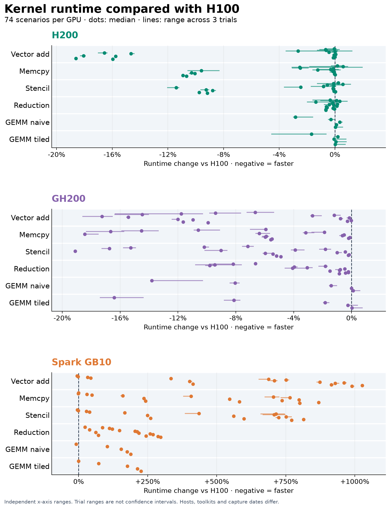

# Results

## Kernel timing

H100, H200, GH200, and GB10 each have 74 configurations × 3 trials × 50 timings: 44,400 samples. Hosts, toolkits, and capture dates differ; ratios describe these runs, not an isolated architecture effect.

[All figures and calculation tables](../results/research-2026-10-20/README.md) · [Raw evidence](../results/README.md)

## Power prediction

The known-device random forest was selected on H100/H200 development data and frozen before final evaluation. The unseen-device objective separately selected a workload-mean baseline.

| Final capture | Forest RMSE | Workload baseline RMSE |
| --- | ---: | ---: |
| New H200 session | 9.56 W | 23.16 W |
| Unseen GH200 | 42.99 W | 34.71 W |
| Unseen GB10 | 379.28 W | 391.27 W |

The H200 session contains 1,153 rows; 24 forest errors exceed 25 W. Transfer to unseen GPUs is poor. Correlated sensor readings are not independent experimental replicates. See the [model card](model-card.md) for features, splits, and serving restrictions.

## Evidence

| Study | Artifacts |
| --- | --- |
| H100 timing and historical A100 comparison | [H100](../results/h100-2026-09-22/), [A100](../results/a100-2026-04-28/) |
| H100 sustained power | [Capture and analysis](../results/h100-power-2026-09-22/REPORT.md) |
| H200, GH200, GB10 and new H200 session | [Frozen validation archive](../results/quality-2026-10-20/README.md) |
| H100 energy-aware tuning | [Trials and confirmation](../results/h100-autotune-2026-09-22/) |

The archive retains raw readings, configuration/source hashes, frozen selections, predictions, and validation receipts. [Reproduction commands](reproducibility.md).
