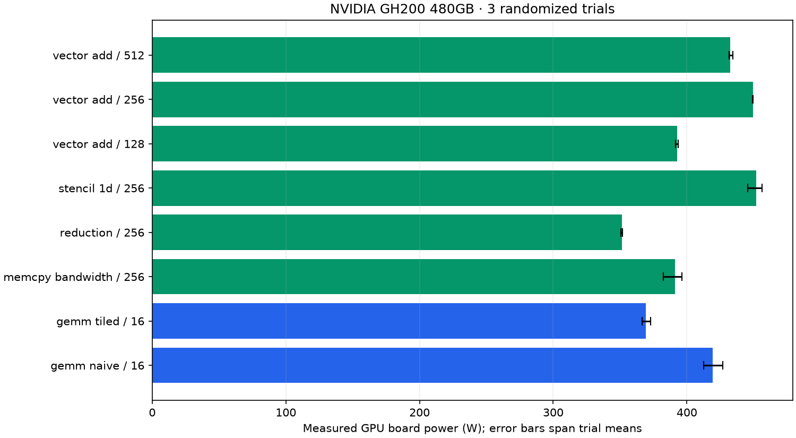

# Measured power and sustained throughput

Device: **NVIDIA GH200 480GB**. 24 workload windows; 2200 raw telemetry rows; 1237 steady-window rows.

| Workload | Block | Board power, mean [trial range] W | Sustained effective GB/s | Sustained GFLOP/s | Estimated mJ/launch |
| --- | ---: | ---: | ---: | ---: | ---: |
| gemm_naive | 16 | 419.2 [412.5, 427.0] | 15.8 | 5406.1 | 1332.160 |
| gemm_tiled | 16 | 369.4 [366.6, 372.8] | 23.9 | 8161.9 | 777.445 |
| memcpy_bandwidth | 256 | 391.1 [382.3, 396.4] | 2535.3 | 0.0 | 82.824 |
| reduction | 256 | 351.2 [350.7, 352.0] | 883.0 | 219.9 | 107.191 |
| stencil_1d | 256 | 451.7 [445.5, 456.3] | 2339.0 | 1461.8 | 103.682 |
| vector_add | 128 | 392.6 [391.6, 393.4] | 2521.1 | 210.1 | 125.392 |
| vector_add | 256 | 449.4 [449.1, 449.7] | 3152.9 | 262.7 | 114.782 |
| vector_add | 512 | 432.6 [431.4, 434.4] | 3008.6 | 250.7 | 115.779 |

## Optimization result

At the matched 2048 × 2048 FP32 GEMM size, tiled GEMM achieved **1.51× sustained throughput** and **41.6% lower estimated energy per launch** than naive GEMM. This compares these custom kernels on this device under the captured protocol.

## Measurement scope

These are real `nvidia-smi:power.draw` readings, not model predictions. Energy is estimated by trapezoidal integration over covered steady samples. Every workload passed its deterministic correctness check.

Each workload executes batches of 100 launches in a persistent allocation for at least 15 seconds. The first and last 2 seconds are excluded from power summaries. Launch throughput uses the complete sustained window including batch synchronization and host launch overhead. Estimated energy per launch combines steady mean watts with whole-window launch rate; it is not an isolated per-kernel energy measurement. Effective bytes/FLOPs use the existing workload formulas, not hardware counters.

Sensor averaging depends on GPU architecture; on Hopper, power telemetry is approximately one-second averaged. Samples taken more often are correlated. Trial ranges are descriptive, not confidence intervals. Pre-workload idle readings include recent thermal history; no idle subtraction is applied. No clocks or power limits were changed. GPU-board power is not wall-socket or full-server power.

Use same-workload, same-size comparisons for optimization. GEMM bytes count matrix sizes and do not measure actual DRAM traffic. These custom FP32 kernels do not use Tensor Cores or cuBLAS.

## Evidence and regeneration

- [Manifest, device, binary/source hashes and protocol](manifest.json)
- [Every telemetry query](telemetry.csv)
- [Steady telemetry for modeling](steady_telemetry.csv)
- [Per-trial summaries](summary.csv)
- [Aggregates](aggregate.csv)
- [Worker JSON and measurement boundaries](workers/)

From the repository root: `python scripts/summarize_power.py --run-dir outputs/quality-2026-10-20/gh200/power`.

Regeneration verifies artifact hashes and recomputes power/energy summaries from raw samples before writing the table and chart.
