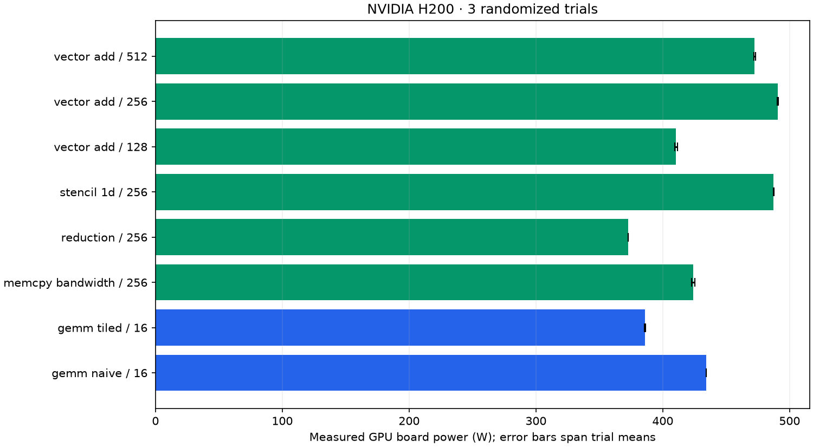

# Measured power and sustained throughput

Device: **NVIDIA H200**. 24 workload windows; 2090 raw telemetry rows; 1153 steady-window rows.

| Workload | Block | Board power, mean [trial range] W | Sustained effective GB/s | Sustained GFLOP/s | Estimated mJ/launch |
| --- | ---: | ---: | ---: | ---: | ---: |
| gemm_naive | 16 | 434.2 [434.2, 434.3] | 15.8 | 5409.6 | 1379.080 |
| gemm_tiled | 16 | 385.9 [385.3, 386.3] | 23.9 | 8164.4 | 811.979 |
| memcpy_bandwidth | 256 | 423.9 [422.7, 425.1] | 2697.0 | 0.0 | 84.372 |
| reduction | 256 | 372.7 [372.6, 372.8] | 887.3 | 221.0 | 113.196 |
| stencil_1d | 256 | 487.4 [487.1, 487.9] | 2463.8 | 1539.9 | 106.214 |
| vector_add | 128 | 410.5 [409.5, 411.6] | 2522.5 | 210.2 | 131.047 |
| vector_add | 256 | 490.9 [490.3, 491.2] | 3438.6 | 286.6 | 114.954 |
| vector_add | 512 | 472.5 [471.7, 473.0] | 3237.7 | 269.8 | 117.513 |

## Optimization result

At the matched 2048 × 2048 FP32 GEMM size, tiled GEMM achieved **1.51× sustained throughput** and **41.1% lower estimated energy per launch** than naive GEMM. This compares these custom kernels on this device under the captured protocol.

## Measurement scope

These are real `nvidia-smi:power.draw` readings, not model predictions. Energy is estimated by trapezoidal integration over covered steady samples. Every workload passed its deterministic correctness check.

Each workload executes batches of 100 launches in a persistent allocation for at least 15 seconds. The first and last 2 seconds are excluded from power summaries. Launch throughput uses the complete sustained window including batch synchronization and host launch overhead. Estimated energy per launch combines steady mean watts with whole-window launch rate; it is not an isolated per-kernel energy measurement. Effective bytes/FLOPs use the existing workload formulas, not hardware counters.

Sensor averaging depends on GPU architecture; on Hopper, power telemetry is approximately one-second averaged. Samples taken more often are correlated. Trial ranges are descriptive, not confidence intervals. Pre-workload idle readings include recent thermal history; no idle subtraction is applied. No clocks or power limits were changed. GPU-board power is not wall-socket or full-server power.

Use same-workload, same-size comparisons for optimization. GEMM bytes count matrix sizes and do not measure actual DRAM traffic. These custom FP32 kernels do not use Tensor Cores or cuBLAS.

## Evidence and regeneration

- [Manifest, device, binary/source hashes and protocol](manifest.json)
- [Every telemetry query](telemetry.csv)
- [Steady telemetry for modeling](steady_telemetry.csv)
- [Per-trial summaries](summary.csv)
- [Aggregates](aggregate.csv)
- [Worker JSON and measurement boundaries](workers/)

From the repository root: `python scripts/summarize_power.py --run-dir outputs/quality-2026-10-20/h200-independent/power`.

Regeneration verifies artifact hashes and recomputes power/energy summaries from raw samples before writing the table and chart.
