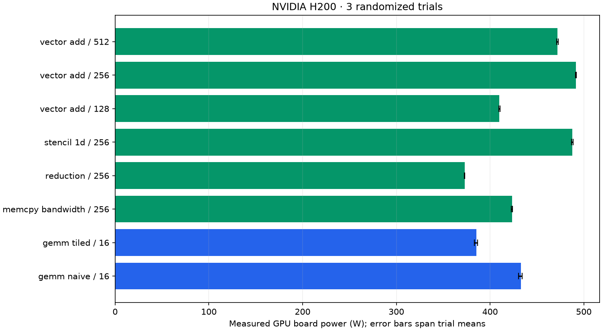

# Measured power and sustained throughput

Device: **NVIDIA H200**. 24 workload windows; 2083 raw telemetry rows; 1153 steady-window rows.

| Workload | Block | Board power, mean [trial range] W | Sustained effective GB/s | Sustained GFLOP/s | Estimated mJ/launch |
| --- | ---: | ---: | ---: | ---: | ---: |
| gemm_naive | 16 | 432.9 [430.3, 434.4] | 15.8 | 5409.1 | 1374.827 |
| gemm_tiled | 16 | 385.6 [383.3, 386.8] | 23.9 | 8163.5 | 811.390 |
| memcpy_bandwidth | 256 | 423.4 [422.6, 423.8] | 2697.2 | 0.0 | 84.273 |
| reduction | 256 | 372.9 [372.7, 373.1] | 887.2 | 220.9 | 113.257 |
| stencil_1d | 256 | 487.8 [487.0, 488.4] | 2464.8 | 1540.5 | 106.243 |
| vector_add | 128 | 410.0 [409.5, 410.9] | 2522.7 | 210.2 | 130.891 |
| vector_add | 256 | 491.7 [491.2, 492.1] | 3438.1 | 286.5 | 115.162 |
| vector_add | 512 | 472.1 [470.9, 472.8] | 3237.6 | 269.8 | 117.431 |

## Optimization result

At the matched 2048 × 2048 FP32 GEMM size, tiled GEMM achieved **1.51× sustained throughput** and **41.0% lower estimated energy per launch** than naive GEMM. This compares these custom kernels on this device under the captured protocol.

## Measurement scope

These are real `nvidia-smi:power.draw` readings, not model predictions. Energy is estimated by trapezoidal integration over covered steady samples. Every workload passed its deterministic correctness check.

Each workload executes batches of 100 launches in a persistent allocation for at least 15 seconds. The first and last 2 seconds are excluded from power summaries. Launch throughput uses the complete sustained window including batch synchronization and host launch overhead. Estimated energy per launch combines steady mean watts with whole-window launch rate; it is not an isolated per-kernel energy measurement. Effective bytes/FLOPs use the existing workload formulas, not hardware counters.

Sensor averaging depends on GPU architecture; on Hopper, power telemetry is approximately one-second averaged. Samples taken more often are correlated. Trial ranges are descriptive, not confidence intervals. Pre-workload idle readings include recent thermal history; no idle subtraction is applied. No clocks or power limits were changed. GPU-board power is not wall-socket or full-server power.

Use same-workload, same-size comparisons for optimization. GEMM bytes count matrix sizes and do not measure actual DRAM traffic. These custom FP32 kernels do not use Tensor Cores or cuBLAS.

## Evidence and regeneration

- [Manifest, device, binary/source hashes and protocol](manifest.json)
- [Every telemetry query](telemetry.csv)
- [Steady telemetry for modeling](steady_telemetry.csv)
- [Per-trial summaries](summary.csv)
- [Aggregates](aggregate.csv)
- [Worker JSON and measurement boundaries](workers/)

From the repository root: `python scripts/summarize_power.py --run-dir outputs/prizepicks-h200-2026-10-20/power`.

Regeneration verifies artifact hashes and recomputes power/energy summaries from raw samples before writing the table and chart.
