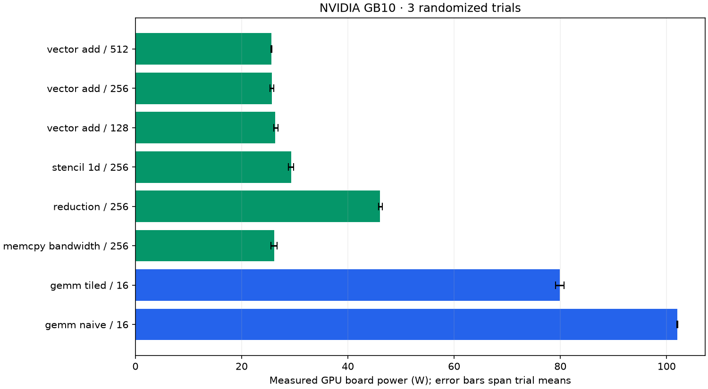

# Measured power and sustained throughput

Device: **NVIDIA GB10**. 24 workload windows; 1905 raw telemetry rows; 1023 steady-window rows.

| Workload | Block | Board power, mean [trial range] W | Sustained effective GB/s | Sustained GFLOP/s | Estimated mJ/launch |
| --- | ---: | ---: | ---: | ---: | ---: |
| gemm_naive | 16 | 102.1 [101.9, 102.1] | 5.3 | 1804.6 | 971.509 |
| gemm_tiled | 16 | 79.9 [79.1, 80.7] | 7.2 | 2455.2 | 559.366 |
| memcpy_bandwidth | 256 | 26.1 [25.5, 26.7] | 243.9 | 0.0 | 57.523 |
| reduction | 256 | 46.0 [45.7, 46.5] | 224.1 | 55.8 | 55.347 |
| stencil_1d | 256 | 29.4 [28.8, 29.7] | 238.8 | 149.2 | 66.036 |
| vector_add | 128 | 26.3 [26.1, 26.8] | 243.7 | 20.3 | 87.039 |
| vector_add | 256 | 25.7 [25.4, 26.0] | 244.0 | 20.3 | 84.803 |
| vector_add | 512 | 25.6 [25.5, 25.7] | 243.9 | 20.3 | 84.599 |

## Optimization result

At the matched 2048 × 2048 FP32 GEMM size, tiled GEMM achieved **1.36× sustained throughput** and **42.4% lower estimated energy per launch** than naive GEMM. This compares these custom kernels on this device under the captured protocol.

## Measurement scope

These are real `nvidia-smi:power.draw` readings, not model predictions. Energy is estimated by trapezoidal integration over covered steady samples. Every workload passed its deterministic correctness check.

Each workload executes batches of 100 launches in a persistent allocation for at least 15 seconds. The first and last 2 seconds are excluded from power summaries. Launch throughput uses the complete sustained window including batch synchronization and host launch overhead. Estimated energy per launch combines steady mean watts with whole-window launch rate; it is not an isolated per-kernel energy measurement. Effective bytes/FLOPs use the existing workload formulas, not hardware counters.

Sensor averaging depends on GPU architecture; on Hopper, power telemetry is approximately one-second averaged. Samples taken more often are correlated. Trial ranges are descriptive, not confidence intervals. Pre-workload idle readings include recent thermal history; no idle subtraction is applied. No clocks or power limits were changed. GPU-board power is not wall-socket or full-server power.

Use same-workload, same-size comparisons for optimization. GEMM bytes count matrix sizes and do not measure actual DRAM traffic. These custom FP32 kernels do not use Tensor Cores or cuBLAS.

## Evidence and regeneration

- [Manifest, device, binary/source hashes and protocol](manifest.json)
- [Every telemetry query](telemetry.csv)
- [Steady telemetry for modeling](steady_telemetry.csv)
- [Per-trial summaries](summary.csv)
- [Aggregates](aggregate.csv)
- [Worker JSON and measurement boundaries](workers/)

From the repository root: `python scripts/summarize_power.py --run-dir outputs/quality-2026-10-20/spark/power`.

Regeneration verifies artifact hashes and recomputes power/energy summaries from raw samples before writing the table and chart.
